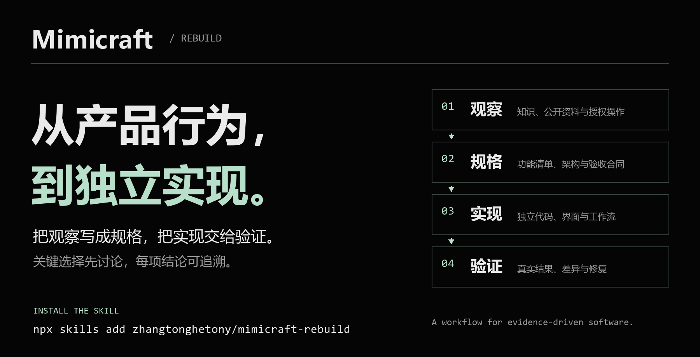
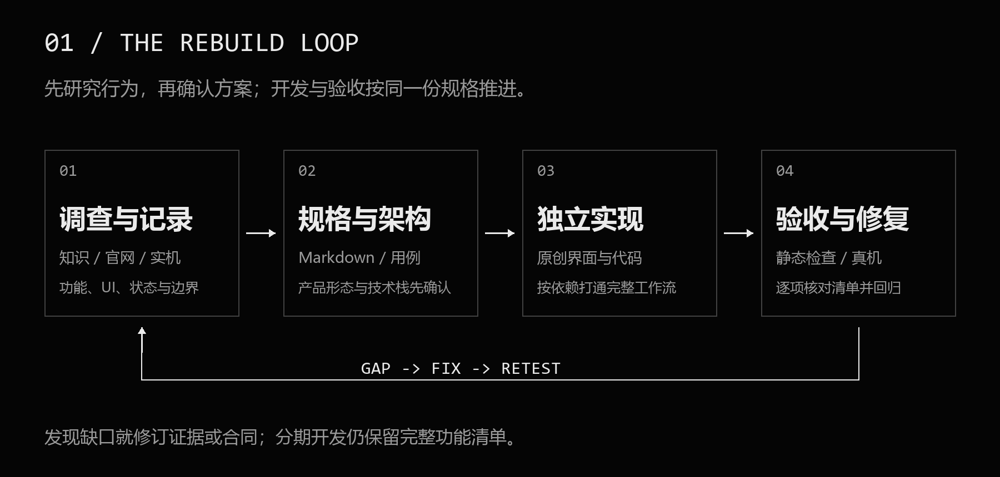
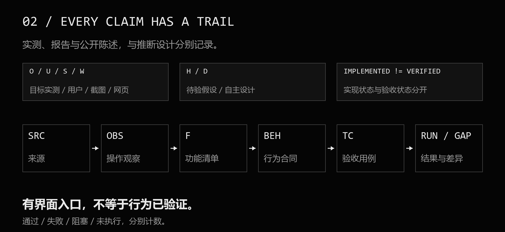
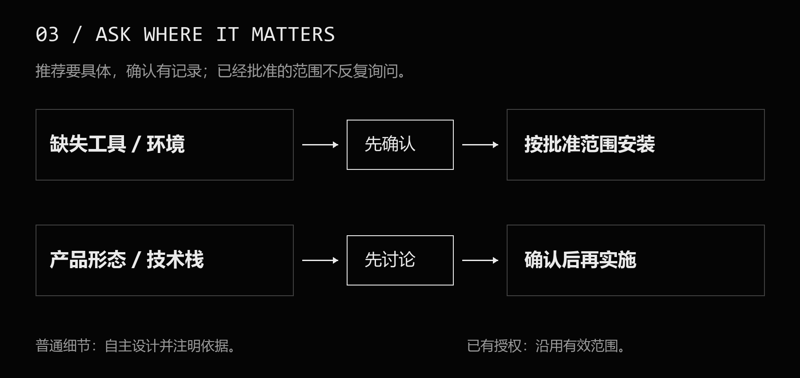

# Mimicraft Rebuild

**从产品行为，到独立实现。**

给出一个产品名，先把它的功能、操作流程和边界研究清楚，再讨论如何实现。Mimicraft Rebuild 是一份可复用的 Agent Skill，把产品调查、规格编写、架构设计、独立开发与逐项验收接成一条可追溯的工作流。



[Skill 入口](SKILL.md) · [记录模板](references/templates.md) · [调查示例](references/ev-example.md) · [MIT 许可](LICENSE)

*An agent skill for behavior-driven software rebuilding: research observable product behavior, write specifications and architecture, agree on key decisions, implement independently, and verify the agreed scope against explicit acceptance cases.*

## 它用来做什么

当你想“参考某款软件，做出适合自己的版本”时，难点往往在代码之前：功能藏在不同菜单里，价格页只列能力，截图只展示一个状态，真正影响体验的细节要实际操作才知道。

这个 Skill 会指导代理从已有知识建立线索，搜索官网帮助、教程和档位说明，再结合用户材料与授权的实机操作记录行为。得到的信息会进入功能清单、行为合同和验收用例，最后用于独立实现与验证。

它也适合只研究一个核心工作流，或只完成调查与规划。用户没有要求开发时，不会自行扩展成完整应用开发。

这套方法从两个 Mimicraft 实验中提炼而来：[Mindmap](https://github.com/zhangtonghetony/mimicraft-mindmap) 与 [Recorder](https://github.com/zhangtonghetony/mimicraft-recorder)。两者的技术栈、产品形态和商业决定不会被固定为后续项目的默认选择。

## 安装与使用

使用支持 Agent Skills 的代理，通过官方 [skills CLI](https://github.com/vercel-labs/skills) 安装：

```bash
npx skills add zhangtonghetony/mimicraft-rebuild --skill mimicraft-rebuild
```

只安装到当前项目的 Codex：

```bash
npx skills add zhangtonghetony/mimicraft-rebuild --skill mimicraft-rebuild -a codex
```

按 CLI 提示选择安装位置和代理。默认是项目级安装；是否需要全局安装由你决定。CLI 需要兼容版本的 Node.js，当前要求以其官方文档为准。命令会获取 CLI 与本 Skill，使用前应符合你自己的工具安装政策。

不使用 CLI，也可以下载源码 ZIP 或克隆仓库，然后在对话中提供 `SKILL.md` 的本地路径，请代理读取并使用：

```bash
git clone https://github.com/zhangtonghetony/mimicraft-rebuild.git
```

安装后，给 Codex 的起始请求可以是：

```text
使用 $mimicraft-rebuild，研究「产品名称」。
本轮先完成调查、完整功能清单、项目文档和架构方案。
安装缺失工具、确定产品形态和技术栈前，先和我讨论。
```

如果已有批准的产品方案，可以直接说明本轮开发范围；Skill 会沿用有效的已有决定，继续普通实现工作。

## 四个阶段



| 阶段 | 主要工作 | 产物 |
| --- | --- | --- |
| 调查与记录 | 知识建立线索；检索公开资料；授权操作目标应用；记录 UI、输入输出、错误、状态与边界 | 来源索引、操作观察、截图证据与功能候选清单 |
| 规格与架构 | 确定范围、行为合同、依赖、数据保存与输出；比较产品形态和技术方案 | Markdown 项目文档、架构图、验收用例与确认记录 |
| 独立实现 | 根据确认的方案按依赖开发；使用独立代码、原创 UI 与合法素材；建立快速预览 | 可运行的应用、阶段结果和实现映射 |
| 验收与修复 | 静态检查、合适的自动化与实机验证；检查输出内容；逐条核对清单并回归缺陷 | 覆盖矩阵、运行记录、差异、修复结果与已知限制 |

开发从一个完整的小闭环开始，逐步覆盖已约定的完整范围。分期不会让未完成的功能从清单中消失。

## 每个结论有来源



Skill 将证据和设计分开记录：

- **O / U / S / W**：目标实测、用户操作报告、截图可见事实、网页陈述。
- **H / D**：待验证的假设，以及明确采用的自主设计。

截图里出现一个按钮，可以证明入口存在；帮助页写了某个功能，可以作为公开陈述；是否真的按预期工作，需要对应的操作和输出证据。用户提供的操作报告也是有效来源，不要求为了形成规格而重复所有已有观察。

常用关联链是 `SRC → OBS → F → BEH → TC → RUN / GAP`，分别对应来源、观察、功能、行为合同、用例、运行结果与差异。已有项目可以继续使用原来的编号。

**已实现、已执行验证、验证通过，以及目标一致性已验证，分别报告。** 失败、阻塞和未执行不会被计入通过数。

## 哪些事项需要先确认



- 新工具、Skill、SDK、运行时或缺失依赖：先说明用途、来源、影响与费用，获准后安装。
- 产品形态、技术栈，以及影响范围和架构的重要变更：提出具体建议与取舍，确认后实施。
- 已明确指定或已批准的方案：在原授权范围内继续，不重复询问。
- 普通交互和未规定细节：可自主形成可迭代设计，标注理由，不冒充目标实测。

有关键事项等待答复时，继续不依赖答复的调查和文档工作。

## 仓库内容

```text
mimicraft-rebuild/
├── SKILL.md                     Skill 入口与四阶段流程
├── README.md                    项目介绍与使用方法
├── LICENSE                      自有内容的 MIT 许可
├── THIRD_PARTY_NOTICES.md        第三方研究截图说明
├── agents/openai.yaml           Codex 的展示信息与默认提示词
├── references/
│   ├── research.md              调查路线与证据分类
│   ├── planning.md              完整文档、形态/技术栈与架构
│   ├── templates.md             八类记录模板
│   ├── verification.md          逐项验收、真实输出与修复
│   └── ev-example.md            EV 录屏调查方法示例
└── assets/
    ├── ev-recorder-main-window.png
    └── diagrams/                四张原创图的 PNG 与可编辑 SVG
```

模板覆盖来源、观察、完整功能矩阵、行为合同、验收用例、关键决策/安装批准、运行/差异、节点日志与接续信息。参考文档按阶段读取，避免每次都加载全部细节。

## 使用边界

这是工作流与记录规范，不捆绑浏览器、computer-use、联网能力或开发 SDK。代理能否完成实机调查，取决于其实际工具、目标访问权限和用户授权；缺失项需先确认，不会为了完成流程擅自安装。

研究默认依据公开信息与授权的外部行为，不反编译、不读取目标内部实现、不绕过付费或访问控制。原产品的会员表用于发现功能，本产品的范围与是否收费由用户决定。附带截图仅为研究示例，不用于新产品的品牌或界面素材。

该 Skill 不承诺自动还原所有隐藏功能，也不把一次机器上的通过扩展为所有环境兼容。结构校验和文档走读不能替代在新目标上的真实端到端使用验证。

## 在 skills.sh 上发现

Skill 本体托管在本 GitHub 仓库。[skills.sh 的官方说明](https://www.skills.sh/docs/faq)采用真实 CLI 安装记录自动发现和统计 Skill；目录与排名由平台更新，不需要另上传一份代码。

安装入口始终是上面的 GitHub 源命令。平台目录入口为：

https://skills.sh/zhangtonghetony/mimicraft-rebuild/mimicraft-rebuild

## 参与改进

欢迎通过 Issue 提供具体目标、受影响阶段、预期行为、实际结果及脱敏证据。建议优先补充可复现的规格缺口和工作流问题。提交内容时保留原始证据与自主推断的区别，不上传密码、验证码、私密录屏或个人设备样本。

本项目的自有文本、模板与原创图采用 [MIT](LICENSE) 许可；第三方研究截图保留原权利，详见 [THIRD_PARTY_NOTICES.md](THIRD_PARTY_NOTICES.md)。本项目并非任何被研究产品或平台的官方项目。
