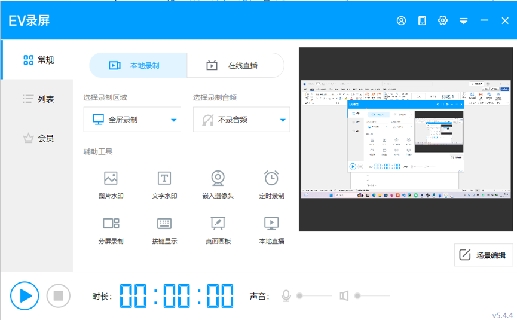

# 示例：如何调查 EV 录屏

这是用户提供的研究示例，不是让 Skill 每次都启动 EV 录屏，也不是通用录屏应用规格。

## 原始截图

- 来源：本次 Skill 创建请求的用户附件，2026-10-31 提供；拍摄时间未知。
- 原图：`assets/ev-recorder-main-window.png`，865 × 535，保留原始字节。
- SHA-256：`7b4ef0a8c6cbe227fc70703e27f4df83f00e3d35841631b994837d5830d04e77`。
- 用途：示范 S 类证据、可见功能入口和观察计划。图中属于第三方产品的名称、图标与布局仅用于研究；不自动获得作为新产品品牌、UI 素材或公开宣传图再利用的授权，不提供法律合规保证。

## 可检索的公开入口

- [官方 PC 帮助目录](https://www.ieway.cn/help/question-evcapture-pc.html)
- [官方付费功能说明](https://www.ieway.cn/evcapture_payinfo.html)
- [用户提供过的具体帮助页](https://www.ieway.cn/help/question-evcapture-pc-177.html)

这些链接来自用户给出的调查路线。本 Skill 创建过程中未把网页内容重新抓取为已核实事实；实际研究时应打开当前页面、记录访问日期和适用版本，沿相关二级教程继续查找。失效时检索官网当前入口，不把旧地址当作仍然有效的保证。

## 从截图能直接记录什么

| S 类可见事实 | 不能由此直接证明 |
| --- | --- |
| 标题为 EV 录屏，右下可见 v5.4.4 | 当前本机安装版本、其他平台版本一致 |
| 可见本地录制/在线直播入口 | 两条链路已配置、可成功使用 |
| 当前显示全屏录制、不录音频、计时 00:00:00 | 可选全部范围、声音选项及其实际行为 |
| 辅助工具有图片水印、文字水印、嵌入摄像头、定时录制 | 叠加顺序、格式限制、摄像头权限、定时触发规则 |
| 可见分屏录制、按键显示、桌面画板、本地直播、场景编辑 | 参数、边界、状态冲突、输出是否包含效果 |
| 可见常规/列表/会员、开始和停止样式控件 | 会员套餐的当前价格、每个控件的禁用/成功逻辑 |

画面预览和工具入口提供观察线索，不代表已经按过按钮、录过文件或测过声音。

## 下一步的实机探索示例

在目标可用、测试与设备权限已明确的前提下：

1. 查版本和当前设置；选无敏感信息的测试画面，完成开始→停止→定位文件→实际播放的闭环。
2. 查看录制范围/音频下拉项，分别登记选项、默认值、禁用条件；对本轮纳入项再执行。
3. 按实际 UI 检查画板、叠加图层等入口，记录启用、修改、关闭及重开后的状态；不凭图标猜成功。
4. 检查设置、列表、导出与代表性异常；每项用 OBS 和证据关联到 F/BEH/TC。
5. 将当前无法访问的档位功能保留为 W/S 类候选，按用户决定纳入自主设计或待验证范围；不能绕过目标的权限控制。

若要自主决定 Web 还是桌面，以及采用哪种语言/捕获/编码方案，应先提出方案与限制并等待用户确认，而不是因为示例曾用某种技术就直接沿用。
