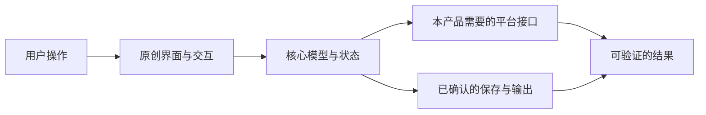

# 完整项目文档与关键决策

## 文档组织

以项目 `plan.md` 为总入口；复杂内容再拆分，保持引用。以下是可裁剪的布局，不是要求预建全部目录：

```text
<project>/
  plan.md                     目标、当前阶段、决策、分期、日志和文档入口
  README.md                   实现后面向使用者的说明、启动方法与真实边界
  docs/
    sources.md                SRC 来源、版本、访问日期与证据性质
    observations/             OBS 操作、状态与截图索引
    evidence/                 目标观察原始材料；敏感材料按项目规则隔离
    feature-inventory.md      完整候选清单、本轮范围及实现/验收矩阵
    product-decisions.md      待确认与已确认的形态、技术、数据和范围决定
    architecture.md           本产品架构、数据流、系统边界与技术假设
    specs/                    BEH 行为合同及 TC 验收用例
    validation/               RUN 实际运行、GAP 差异与修复、最终审计
  src/ 或 app/                确认架构后的独立实现
```

无需先为未开始的实现建立空模块；一个小项目可以把清单、合同和测试放进同一文档。原始截图不是默认公开发行物，公开代码与研究材料是否分离要明确。

## plan.md 的必要内容

1. 产品定位、目标用户和任务；目标产品与版本/环境；本轮交付物与边界。
2. 全量功能来源与清单、分期和依赖；明确原付费功能如何纳入本产品。
3. 关键 UI、信息架构、操作流程、状态转移、错误与恢复；原创表达方向。
4. 数据结构、标识/引用、历史与持久化；输入输出、文件格式/兼容性和迁移范围。
5. 候选产品形态和技术方案、架构图、确认记录、未验证的技术假设。
6. 环境现状、缺失项与待批准的安装；开发启动、预览与验证流程。
7. 对应功能的验收用例、完成标准、人工/设备测试、发布包检查与适用环境。
8. 风险与待确认项、阶段顺序/退出条件、实际进展、差异和下一步。

不是所有项目都需要账号、云存储、支付、实时协作或通用插件平台；没有用户需求时不要顺手加入。

## 产品形态与技术栈确认

判断依据应来自能力需求和实际环境，不由熟悉程度替代：

| 比较项 | 需讨论的具体问题 |
| --- | --- |
| 平台能力 | 浏览器权限能否满足？是否必须访问原生窗口、硬件、后台或本地文件系统？ |
| 分发与预览 | 用户需要网页直达、便携程序还是安装包？怎样快速看效果？ |
| 数据与依赖 | 本地/云端、离线、文件交换、隐私、网络和第三方服务依赖是什么？ |
| 性能与兼容 | 延迟、内存、编码或渲染瓶颈、OS/API/驱动支持范围如何验证？ |
| 开发维护 | 当前工具、团队熟悉程度、测试工具、打包升级、依赖许可与运行成本怎样？ |

给一个推荐方案和有意义的替代方案，列出取舍与需要验证的假设；已有明确约束时不为凑选项提出明显不适用的方案。

在实施前取得用户对产品形态、技术栈的确认；新外部费用、云端服务、兼容性范围或关键数据合同的变动也需讨论。确认后登记 `DEC`：选择、理由、影响、用户授权依据、日期、有效范围。被用户拒绝的方案不悄悄安装或实现。

环境安装用独立清单记录批准范围；依赖可在一次明确的安装计划中批量批准，不必逐个包反复打断。形态和技术栈已确认、仅安装尚未批准时，可继续不依赖新增环境的设计和代码编辑，但不能运行会自动拉取缺失环境的命令；不能据此绕过形态/技术栈的确认。

## 架构图要求

在 Markdown 内使用 Mermaid，必要时另输出 SVG/PNG。按当前产品画出入口、核心状态/数据、系统接口、保存/输出和外部服务的数据流；明确哪些组件不在产品内。

概念图示例（需按实际范围裁剪，不是默认实现）：



另外按需要绘制状态图，例如“空闲→准备→处理中→收尾→完成/失败”。标出取消/恢复分支、资源所有者与释放边界。不得把本产品图命名为“目标软件内部架构已还原”。

## 规格冻结与变更

每次开发批次引用一个可定位的文档修订或 Git 提交。普通细节以 D 类设计补入合同；影响关键选择的变更先确认，再同步架构、清单和用例。旧失败证据与历史结论保留，不能靠改清单分母让完成率变成 100%。
